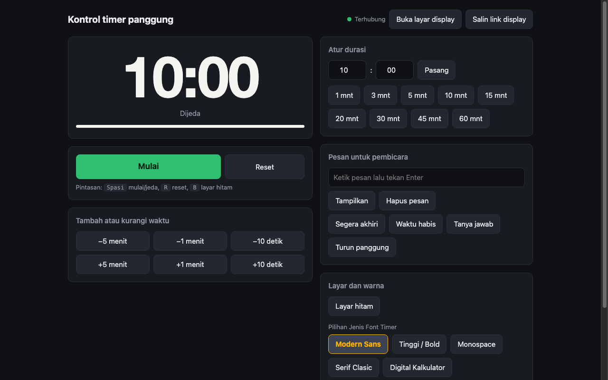
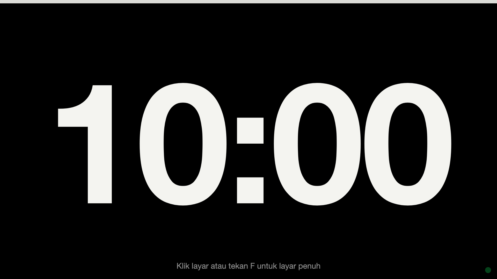
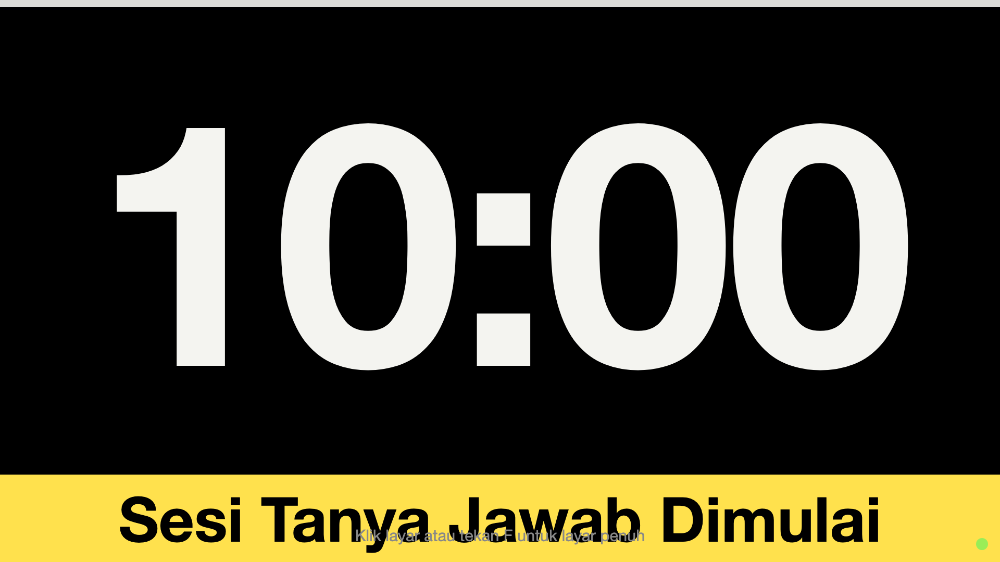
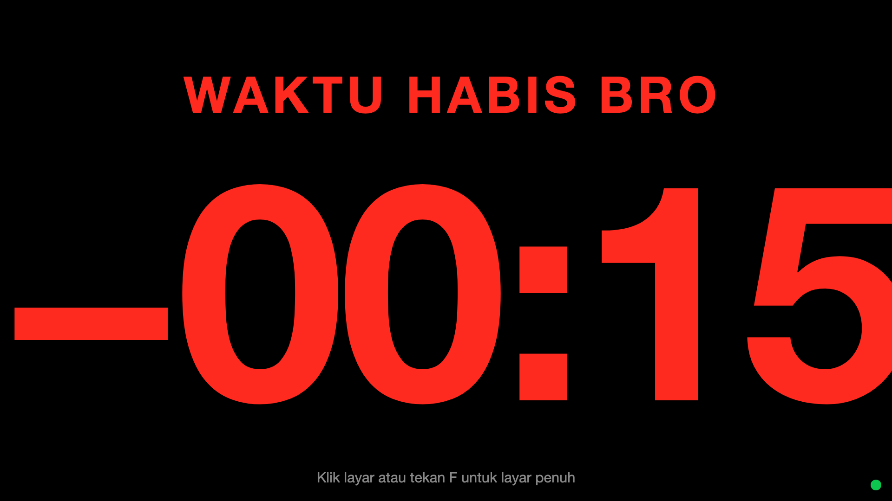

# ⏱️ Stage Timer (Local LAN Time Keeper)

Aplikasi pengatur waktu panggung (*stage timer*) berbasis web untuk jaringan lokal (LAN). Dirancang khusus untuk seminar, konferensi, ibadah, dan acara panggung lainnya tanpa memerlukan koneksi internet, tanpa database, dan tanpa dependensi eksternal (*zero npm dependencies*).

---

## 📸 Preview Tampilan

### 1. Panel Operator (`control.html`)
Panel lengkap untuk operator/time keeper: mulai/jeda, preset durasi, penyesuaian waktu instan, pemilihan jenis font, kustomisasi teks waktu habis, pesan kilat panggung, dan blackout.



### 2. Layar Panggung Normal (`display.html`)
Tampilan panggung yang bersih dan kontras tinggi, angka otomatis menyesuaikan resolusi monitor/TV panggung secara proporsional.



### 3. Tampilan Pesan / Peringatan untuk Pembicara
Operator dapat mengirim pesan kustom atau pesan cepat (*quick message*) yang langsung muncul di bagian bawah layar panggung.



### 4. Tampilan Waktu Habis (*Overtime*)
Saat waktu habis, warna otomatis berubah merah dengan label peringatan kustom (misal: "WAKTU HABIS") dan timer mulai menghitung durasi waktu lebih (*minus*).



---

## ✨ Fitur Unggulan

- ⚡ **Tanpa Dependensi External (`Zero npm install`)**: Cukup gunakan Node.js bawaan, langsung jalan dengan `node server.js`.
- 🌐 **100% Offline di Jaringan Lokal (LAN)**: Bebas gangguan internet mati di lokasi acara.
- 🔄 **Realtime & Sinkron**: Menggunakan Server-Sent Events (SSE) dengan mekanisme sinkronisasi waktu berbasis `endsAt` agar semua layar sinkron presisi (< 1 detik).
- 🔤 **Pilihan Jenis Font Timer**:
  - *Modern Sans* (standar bersih & jelas)
  - *Tinggi / Bold* (Impact / Condensed)
  - *Monospace* (lebar karakter sejajar)
  - *Serif Classic* (formal)
  - *Digital Kalkulator* (efek angka kalkulator/jam digital LED)
- ✍️ **Kustom Teks Waktu Habis**: Bebas mengganti teks peringatan ketika waktu habis (contoh: *"WAKTU HABIS"*, *"TIME IS UP"*, *"TURUN PANGGUNG"*).
- 💬 **Pesan Panggung**: Kirim pesan langsung ke pembicara tanpa mengganggu angka timer.
- ⬛ **Blackout Mode**: Tombol instan untuk menggelapkan layar display panggung.
- 📱 **Multi-Device Support**: Mendukung banyak display dan panel kontrol sekaligus secara bersamaan (PC, laptop, tablet, atau smartphone).
- 👁️ **Mode Layar Penuh & Wake Lock**: Tekan tombol **F** atau klik layar display untuk *fullscreen*. Layar dijaga agar tidak otomatis *sleep*.

---

## 🚀 Panduan Instalasi & Penggunaan

### 1. Prasyarat
- Komputer dengan **Node.js** terpasang (versi 16 atau lebih baru).

### 2. Jalankan Server
Buka folder project di terminal / command prompt, lalu jalankan:

```bash
node server.js
```

Terminal akan menampilkan alamat IP yang bisa diakses di jaringan lokal Anda:
```text
Stage Timer berjalan.

  [en0]
    Kontrol : http://192.168.1.10:3000/control.html
    Display : http://192.168.1.10:3000/display.html

  Di PC server sendiri bisa pakai http://localhost:3000
```

### 3. Membuka di Layar Panggung (Display PC)
- Buka browser di PC/laptop yang terhubung ke monitor panggung.
- Akses alamat: `http://<IP-SERVER>:3000/display.html`
- Tekan **F** atau klik layar untuk layar penuh.

### 4. Membuka di Laptop / HP Operator (Control PC)
- Buka browser di laptop operator atau smartphone yang terhubung ke Wi-Fi yang sama.
- Akses alamat: `http://<IP-SERVER>:3000/control.html`

---

## ⌨️ Pintasan Keyboard (Halaman Kontrol)

| Tombol | Fungsi |
|---|---|
| <kbd>Spasi</kbd> | Mulai / Jeda timer |
| <kbd>R</kbd> | Reset timer ke durasi awal |
| <kbd>B</kbd> | Toggle Layar Hitam (*Blackout*) |

---

## ⚙️ Opsi Konfigurasi Port

Secara default aplikasi menggunakan port `3000`. Jika ingin mengganti port:

**Linux / macOS:**
```bash
PORT=8080 node server.js
```

**Windows (PowerShell):**
```powershell
$env:PORT=8080; node server.js
```

**Windows (CMD):**
```cmd
set PORT=8080 && node server.js
```

---

## 📁 Struktur File

```text
stage-timer/
├── server.js              # Server HTTP + SSE tanpa dependensi
├── package.json           # Metadata project
├── README.md              # Dokumentasi
├── prd.md                 # Product Requirement Document
├── screenshots/           # Screenshot preview aplikasi
│   ├── control.png
│   ├── display.png
│   ├── display-message.png
│   └── display-overtime.png
└── public/
    ├── common.js          # Logika sinkronisasi SSE dan format jam
    ├── display.html       # Antarmuka layar panggung
    └── control.html       # Antarmuka operator/kontrol
```

---

## 📄 Lisensi

MIT License - Bebas digunakan dan dimodifikasi untuk kebutuhan acara Anda.
